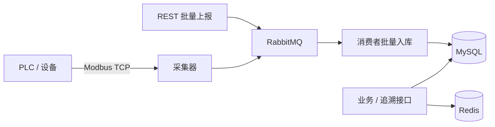

# MesDemo — 离散制造执行系统（MES）后端

> **项目性质**：盘古产教联合实训项目 · 智能制造方向
> **说明**：实训作品，非商业生产系统；数据均为本地演示数据。详细背景与完成情况见 [项目介绍](docs/PROJECT_INTRO.md)。

基于 Spring Boot 3 的 MES 后端，覆盖「工单 → 任务 → 工序 → 领料 → 库存 → 质量 → 设备 → 排产」主链路，并提供设备数据采集、批次追溯与运维配套。

## 架构



## 技术栈

| 类别 | 选型 |
| --- | --- |
| 语言 / 运行时 | Java 17 |
| 框架 | Spring Boot 3.5.6、Spring Security |
| 持久层 | MyBatis-Plus 3.5.6、MyBatis XML、Spring Data JPA（用户/角色/登录日志） |
| 数据库 | MySQL 8 |
| 缓存 | Redis 7（Spring Cache） |
| 消息队列 | RabbitMQ 3（设备数据异步入库） |
| 工业协议 | Modbus TCP（j2mod，读取保持寄存器；内置从站模拟器） |
| 鉴权 | JWT（jjwt 0.11.5）+ RBAC |
| 对象映射 | MapStruct、BeanUtils |
| 接口文档 | Knife4j 4.5（jakarta）/ OpenAPI 3 |
| 运维 | Docker Compose、Actuator、Flyway 替代方案（`schema.sql`） |
| 构建 | Maven |

## 功能模块

| 模块 | 主要内容 |
| --- | --- |
| 生产工单 | 工单 CRUD、状态流转（draft → planned → released → in_progress → completed / cancelled） |
| 生产任务 | 按工单生成任务、派工、开工/完工/暂停、进度与工时回写 |
| 工单-任务联动 | 任务进度汇总回写工单完成数量，任务状态变化驱动工单状态 |
| 工艺路线 / 工序 | 路线与工序维护、标准工时、OEE 计算 |
| BOM / 物料 | BOM 明细、物料主数据、批量导入 |
| 库存 | 库位库存、批次库存、锁定/解锁、调拨、调整、库存流水 |
| 领料 | 创建、执行拣料（锁定库存）、完成出库（真实扣减）、取消释放 |
| 质量 | 检验计划/任务、缺陷代码/明细、合格率、Pareto、SPC |
| 设备 | 设备台账、点检、保养、故障记录、状态日志 |
| 设备数据 | REST 批量上报、RabbitMQ 异步入库、Modbus TCP 主动采集、实时/历史查询 |
| 追溯 | 批次 → 质量任务 → 缺陷 → 工单 → 工序任务 → 领料 → 库存批次 |
| 排产 | 排产计划、排产明细、班次日历 |
| 系统 | 登录鉴权、用户/角色、登录日志 |

## 核心实现

### 1. 工单状态机与任务联动

`ProductionCoordinatorServiceImpl` 在任务进度更新后汇总工单下所有任务状态，推导工单状态并回写完成数量与实际起止时间。

### 2. OEE 计算

`ProcessStepServiceImpl#calculateOEE` 按 `可用率 × 表现性 × 质量指数` 计算设备综合效率。

### 3. 并发安全的库存扣减

库存变更全部走数据库条件更新，不再 `selectById → set → updateById`：

```sql
UPDATE mes_inventory
SET locked_quantity = locked_quantity + #{quantity}
WHERE id = #{id} AND current_quantity - locked_quantity >= #{quantity};

UPDATE mes_inventory
SET current_quantity = current_quantity - #{quantity},
    locked_quantity = locked_quantity - #{quantity}
WHERE id = #{id}
  AND current_quantity >= #{quantity}
  AND locked_quantity >= #{quantity};
```

影响行数为 0 即库存不足，由数据库行锁保证并发下不超卖 / 不超锁。领料单完成时真实扣减，取消时释放锁定。

### 4. 设备数据采集链路

```
REST 上报 / Modbus TCP 采集
        ↓
  DeviceDataPublisher
        ↓
RabbitMQ (mes.device.data.queue)
        ↓
DeviceDataConsumer → 批量入库（INSERT IGNORE）
```

- `POST /api/production-data/batch` 返回后立即异步入库，接口不做长事务。
- `(task_id, data_type, collection_time)` 唯一键保证重复上报幂等。
- Modbus 采集器按配置轮询从站寄存器，映射为产量/质量/设备状态数据。

寄存器约定（功能码 0x03，起始地址 0）：

| 地址 | 含义 |
| --- | --- |
| 0 | 累计产量 |
| 1 | 累计合格数 |
| 2 | 设备状态（1 运行 / 2 空闲 / 3 故障） |
| 3 | 任务 ID（0 时使用配置默认值） |

### 5. Redis 缓存

- `batchTrace`：批次追溯结果缓存 10 分钟，降低多表关联查询压力。
- `deviceLatest`：设备最新数据缓存；新数据入库时清空，避免读到旧值。
- 值序列化使用 Jackson + 限定包名白名单，禁止任意类型反序列化。

### 6. 批次全流程追溯

`GET /api/trace/batch/{batchNo}` 返回 `BatchTraceVO`，串联质量任务、缺陷明细、工单、工序任务、领料明细与库存批次；无关联记录返回 404。

## 快速开始

### 1. 启动基础设施

```bash
docker compose up -d
```

启动 Redis（6379）与 RabbitMQ（5672，管理台 15672，账号 `mes / mes123`）。

### 2. 数据库

无需手工建库。JDBC URL 带 `createDatabaseIfNotExist=true`，启动时 `schema.sql` 自动建表（`CREATE TABLE IF NOT EXISTS`），Hibernate 负责 JPA 表结构。脚本内置演示数据，批次 `DEMO-2026-001` 可直接用于追溯演示。

默认连接：`localhost:3306/mes`，账号 `root / 1234`，可用环境变量覆盖。

### 3. 启动应用

```bash
mvn spring-boot:run
```

默认账号（首次启动由 `DataInitializer` 创建）：

```
用户名：admin
密码：admin123
```

### 4. 登录

```bash
curl -X POST http://localhost:8080/api/auth/login \
  -H "Content-Type: application/json" \
  -d '{"username":"admin","password":"admin123"}'
```

后续请求携带 `Authorization: Bearer <token>`。

### 5. 接口文档

- Knife4j UI：`http://localhost:8080/doc.html`
- OpenAPI JSON：`http://localhost:8080/api-docs`
- 健康检查：`http://localhost:8080/actuator/health`（公开）

## 环境变量

| 变量 | 默认值 | 说明 |
| --- | --- | --- |
| `DB_HOST` / `DB_PORT` | `localhost` / `3306` | MySQL 地址 |
| `DB_USERNAME` / `DB_PASSWORD` | `root` / `1234` | MySQL 账号 |
| `REDIS_HOST` / `REDIS_PORT` | `localhost` / `6379` | Redis |
| `RABBITMQ_HOST` / `RABBITMQ_PORT` | `localhost` / `5672` | RabbitMQ |
| `RABBITMQ_USERNAME` / `RABBITMQ_PASSWORD` | `mes` / `mes123` | RabbitMQ 账号 |
| `JWT_SECRET` | 内置开发密钥 | 生产环境必须替换 |
| `MODBUS_ENABLED` | `false` | 开启 Modbus 采集 |
| `MODBUS_SIMULATOR` | `false` | 开启内置 Modbus 从站模拟器 |
| `MODBUS_HOST` / `MODBUS_PORT` | `localhost` / `5020` | 从站地址 |
| `MODBUS_TASK_ID` | `1` | 寄存器未给任务 ID 时的默认任务 |

## 设备采集演示

同一进程同时启动模拟从站与采集器：

```bash
mvn spring-boot:run -Dspring-boot.run.arguments="--mes.modbus.enabled=true --mes.modbus.simulator=true"
```

约 3 秒后开始每 5 秒采集一次，查询：

```bash
curl "http://localhost:8080/api/production-data/task/1" -H "Authorization: Bearer <token>"
```

### REST 上报示例

```bash
curl -X POST http://localhost:8080/api/production-data/batch \
  -H "Authorization: Bearer <token>" \
  -H "Content-Type: application/json" \
  -d '[
    {"taskId":1,"dataType":"quantity","dataValue":"10"},
    {"taskId":1,"dataType":"quality","dataValue":"qualified"}
  ]'
```

返回：

```json
{"code":200,"message":"数据已接收，异步入库","data":"accepted"}
```

## 追溯接口示例

```bash
# 内置演示批次，可直接返回完整链路
curl http://localhost:8080/api/trace/batch/DEMO-2026-001 \
  -H "Authorization: Bearer <token>"
```

```json
{
  "code": 200,
  "data": {
    "batchNo": "BATCH20240101",
    "inspectionTasks": [{ "taskNo": "QT...", "batchNo": "BATCH20240101", "orderNo": "WO..." }],
    "defects": [{ "defectCode": "D001", "defectName": "表面划痕", "defectQuantity": 2, "batchNo": "BATCH20240101" }],
    "orders": [{ "orderCode": "WO...", "status": "in_progress" }],
    "processTasks": [{ "taskCode": "TASK...", "operationSequence": 1 }],
    "pickLists": [{ "pickListCode": "PL...", "workOrderCode": "WO..." }],
    "pickedMaterials": [{ "materialCode": "M001", "batchNumber": "BATCH20240101" }],
    "inventoryLots": [{ "materialCode": "M001", "currentQuantity": 100 }]
  }
}
```

## 测试

```bash
# 全量测试（需 MySQL、Redis、RabbitMQ 已启动）
mvn test

# 仅并发与追溯测试
mvn -Dtest=InventoryConcurrencyTest test
```

`InventoryConcurrencyTest` 覆盖：

| 用例 | 断言 |
| --- | --- |
| 20 线程并发锁定 100 库存，每次 10 | 只成功 10 次，`locked_quantity = 100` |
| 10 线程并发扣减 50 已锁定库存，每次 10 | 只成功 5 次，现存量与锁定量归零 |
| 按批次写入缺陷后查询追溯 | 追溯结果包含该缺陷节点 |

## 项目结构

```
src/main/java/com/mes
├── config          # 安全、Jackson、Redis、RabbitMQ、数据初始化
├── controller      # REST 接口层
├── service         # 业务接口与实现（含 BatchTraceService、DeviceDataPublisher）
├── mq              # RabbitMQ 消费者
├── modbus          # Modbus TCP 采集器与从站模拟器
├── mapper          # MyBatis-Plus / 注解 SQL
├── repository      # Spring Data JPA（用户、角色、登录日志）
├── entity          # 数据库实体
├── dto / vo        # 入参 / 出参
├── security        # JWT 过滤器、认证入口
└── util
src/main/resources
├── application.yml
├── schema.sql      # 业务表建表脚本（幂等）
└── mapper          # MyBatis XML
tools/gen_schema.py # 从实体生成建表脚本
docs/PROJECT_INTRO.md # 项目介绍（背景、方案、完成情况、边界）
```

## 说明

- 工业协议目前实现 Modbus TCP 客户端与本地从站模拟器；未接入 OPC UA / MQTT，也未对接真实 PLC。
- 缓存与消息队列均为开发默认配置，生产环境需替换账号、启用持久化与监控。
- 用户/角色/登录日志使用 JPA，业务表使用 MyBatis-Plus，复杂查询使用 XML。
- 本项目为盘古产教联合实训项目，仅用于学习、实训与求职展示。
