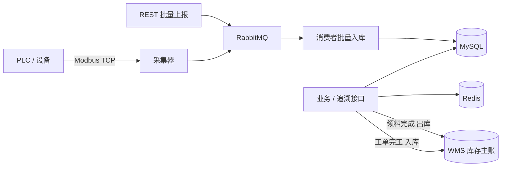

# MesDemo 项目介绍

## 一、项目概况

| 项 | 内容 |
| --- | --- |
| 项目名称 | MesDemo — 离散制造执行系统（MES）后端 |
| 项目性质 | 盘古产教联合实训项目 |
| 项目方向 | 智能制造 / 工业软件后端开发 |
| 项目形态 | 可独立运行的 Spring Boot 后端服务 |
| 技术栈 | Java 17、Spring Boot 3、MyBatis-Plus、MySQL、Redis、RabbitMQ、Modbus TCP、JWT、Docker |
| 外部集成 | WMS REST 接口（领料出库、完工入库） |
| 项目说明 | 实训作品，非商业生产系统；数据均为本地演示数据 |

## 二、项目背景与目标

制造业数字化转型中，MES（制造执行系统）位于计划层与控制层之间，负责把生产计划拆解为可执行的工单与工序任务，并管理物料、库存、质量和设备数据。

本项目为盘古产教联合实训项目，目标是完成一个覆盖主要业务流程的 MES 后端，而不是单表 CRUD 练习。具体目标包括：

1. 理解离散制造的业务主线：工单 → 任务 → 工序 → 领料 → 库存 → 质检 → 追溯。
2. 使用 Spring Boot 完成后端分层、鉴权、异常处理和接口文档。
3. 处理真实工程问题：库存并发、批次追溯、设备数据采集、异步入库与缓存。
4. 完成与外部 WMS 的库存协同：领料出库、完工入库、幂等重试与事务回滚。
5. 补齐可运行性：建表脚本、演示数据、Docker 依赖编排、健康检查与集成测试。

## 三、项目内容

系统围绕生产工单组织业务：

- 工单下发给生产任务，任务完成后进度回写工单。
- 任务执行前通过领料单锁定库存，领料完成时扣减库存，取消时释放锁定。
- 质量检验产生检验任务与缺陷明细，支撑合格率、Pareto 与 SPC 分析。
- 设备台账管理点检、保养和故障记录。
- 生产数据通过 REST 或 Modbus TCP 采集，经 RabbitMQ 异步入库。
- 领料完成时同步 WMS 出库，工单首次完工时同步 WMS 成品入库，WMS 作为库存主账。
- 以批次号为入口，串联质量、缺陷、工单、工序、领料和库存，形成追溯链路。

### 功能模块

| 模块 | 主要内容 |
| --- | --- |
| 生产工单 | 工单维护、状态流转、优先级、进度 |
| 生产任务 | 按工单生成任务、派工、开工/完工/暂停、工时回写 |
| 工艺路线 | 工艺路线与工序维护、标准工时 |
| BOM / 物料 | BOM 明细、物料主数据、批量导入 |
| 库存 | 库位库存、批次库存、锁定/解锁、调拨、库存流水 |
| 领料 | 领料单创建、拣料锁定、完成扣减、取消释放、WMS 出库 |
| WMS 集成 | 领料出库、完工入库、幂等键、超时与事务回滚 |
| 质量 | 检验计划/任务、缺陷代码/明细、合格率、Pareto、SPC |
| 设备 | 设备台账、点检、保养、故障、状态日志 |
| 设备数据 | REST 上报、Modbus TCP 采集、MQ 异步入库、实时查询 |
| 追溯 | 批次 → 质量任务 → 缺陷 → 工单 → 工序 → 领料 → 库存 |
| 排产 | 排产计划、排产明细、班次日历 |
| 系统管理 | JWT 登录、用户、角色、登录日志 |

## 四、技术方案



主要设计决策：

1. **分层结构**：Controller → Service → Mapper，DTO/VO 与实体分离。
2. **工单状态机**：任务状态汇总后反推工单状态，避免两张表状态不一致。
3. **库存并发安全**：使用带条件的 UPDATE 完成锁定与扣减，影响行数为 0 即判定库存不足，不依赖应用层加锁。
4. **批次追溯**：以批次号查询质量任务、缺陷、领料明细与库存，再通过工单号关联工单和工序任务。
5. **设备采集**：Modbus TCP 读取保持寄存器，按任务计算产量增量；REST 与 Modbus 两条入口统一进入 RabbitMQ，由消费者批量入库。
6. **幂等与缓存**：生产数据以 `(task_id, data_type, collection_time)` 唯一键做幂等；批次追溯与设备最新数据进入 Redis。
7. **WMS 库存协同**：WMS 作为库存主账，MES 本地库存作为车间执行镜像。领料完成先扣本地再调 WMS 出库，工单首次完工推成品入库；调用失败回滚 MES 事务，固定 `requestId` 支持幂等重试。
8. **可运行性**：`schema.sql` 自动建表并写入演示数据，Docker Compose 编排 Redis/RabbitMQ，Actuator 提供健康检查。

### WMS 集成说明

系统与 WMS 有两个方向的库存协同：

| 方向 | 触发点 | WMS 接口 | 幂等键 |
| --- | --- | --- | --- |
| 领料出库 | 领料单完成，逐条明细扣减本地库存后 | `POST /api/open/inventory/outbound` | `MES-PICKLIST-{pickListId}-ITEM-{detailId}` |
| 完工入库 | 工单状态首次变为 `completed` | `POST /api/open/inventory/inbound` | `MES-ORDER-{orderId}-FINISHED-IN` |

实现要点：

- 请求头携带 `X-Integration-Key`，超时时间可配置（默认连接 3 秒、读取 5 秒）。
- 出库按领料明细传物料编码、仓库编码、实拣数量、批次号与来源单号；实拣数量必须是整数，库位必须关联仓库编码，否则拒绝同步。
- 完工入库使用工单产品编码、完成数量、工单号作为批次，写入配置的成品仓。
- WMS 调用位于 MES 事务内，失败抛业务异常并回滚本地库存与工单状态。
- `WMS_ENABLED=false` 时可关闭外部调用，只保留 MES 本地库存逻辑，便于单独联调。
- 详细字段映射与验证步骤见 [WMS 集成文档](WMS_INTEGRATION.md)。

## 五、完成情况

| 指标 | 结果 |
| --- | --- |
| 业务模块 | 15 个 |
| REST 接口 | 160+ |
| 数据库表 | 20+ |
| 核心链路 | 工单、任务、库存、领料、质量、追溯均可走通 |
| 设备采集 | REST 上报与 Modbus TCP 采集均已联调 |
| WMS 集成 | 领料出库、完工入库、幂等键、超时与事务回滚已实现 |
| 集成测试 | 并发库存锁定、并发扣减、追溯缺陷节点，3/3 通过 |
| 启动方式 | 依赖 Docker + MySQL，应用一条命令启动 |

## 六、运行与演示

```bash
# 1. 启动 Redis 与 RabbitMQ
docker compose up -d

# 2. 启动应用
mvn spring-boot:run

# 3. 登录
curl -X POST http://localhost:8080/api/auth/login \
  -H "Content-Type: application/json" \
  -d '{"username":"admin","password":"admin123"}'

# 4. 查看完整批次追溯（内置演示数据）
curl http://localhost:8080/api/trace/batch/DEMO-2026-001 \
  -H "Authorization: Bearer <token>"
```

演示账号：`admin / admin123`。接口文档：`http://localhost:8080/doc.html`。

Modbus 演示：

```bash
mvn spring-boot:run -Dspring-boot.run.arguments="--mes.modbus.enabled=true --mes.modbus.simulator=true"
```

WMS 联调：

```bash
# 指向实际 WMS 地址；没有 WMS 时可关闭，只验证 MES 本地库存
WMS_ENABLED=true WMS_BASE_URL=http://localhost:8088 WMS_API_KEY=<key> mvn spring-boot:run
```

WMS 作为库存主账时，需要先在 WMS 中准备物料、仓库和库存，且物料编码与 MES 一致、MES 库位已配置仓库编码。具体步骤见 [WMS 集成文档](WMS_INTEGRATION.md)。

## 七、项目边界

本项目定位为实训作品，以下能力为演示级：

- 工业协议实现了 Modbus TCP 客户端与本地从站模拟器，未对接真实 PLC，也未实现 OPC UA / MQTT。
- 消息队列为单队列 + 消费入库，未实现死信队列、重试策略与消息补偿。
- 接口鉴权目前只做登录认证，角色权限尚未细化到接口级。
- 无前端页面，接口通过 Knife4j 或 curl 调试。
- 未做性能压测、监控告警、备份恢复等生产运维能力。
- WMS 为外部系统，本仓库不包含 WMS 服务；联调需要可用的 WMS 接口或关闭 `WMS_ENABLED`。
- MES 本地库存与 WMS 库存不在同一数据库事务内，属于最终一致；当前依靠“MES 回滚 + WMS 幂等重试”保证可恢复，未实现自动对账与 WMS → MES 回写。

后续可改进方向：接口级权限、批次谱系数据模型、MQ 可靠性、多设备采集配置化、真实设备联调、WMS 对账任务与补偿机制。

## 八、项目声明

本项目为盘古产教联合实训项目，仅用于学习、实训与求职展示。项目中的账号、密钥、数据库与业务数据均为本地演示用途，不涉及任何真实生产数据或商业系统。
